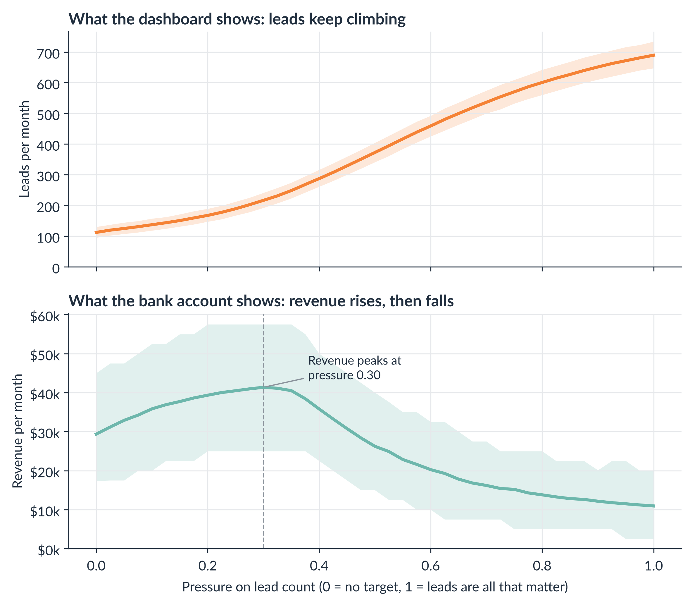

# The Cobra Effect for Marketers

[](https://colab.research.google.com/github/joedom99/cobra-effect-for-marketers/blob/main/cobra_effect_for_marketers.ipynb)


[](LICENSE)

Companion notebook for the Marketing Data Science article **"The Cobra Effect: When Marketing Metrics Bite Back."**



## What This Is

Goodhart's Law says that when a measure becomes a target, it stops being a good measure. This notebook makes that idea visible with a Monte Carlo simulation of a marketing team that gets a bonus for every lead it generates.

The team can find genuine prospects (slow, expensive, and they buy) or use cheap tactics (fast, easy, and they almost never buy). Sales has limited time and can't tell the two apart until they call. As pressure on lead count rises, the notebook tracks what happens to the metric (leads) and the goal (revenue).

Everything is simulated and every assumption lives in one cell, so you can change it and rerun. A fixed random seed means your results will match mine.

## What's Inside

| Section | What it shows |
|---|---|
| 1. Setup and assumptions | All parameters in one place, plus the behavioral model |
| 2. The proxy works, at first | Leads and revenue move together under light pressure |
| 3. The signature chart | Leads keep climbing while revenue rises, peaks, and falls |
| 4. The lead mix | Junk leads crowd out genuine ones and swamp sales capacity |
| 5. The correlation breaks down | The same metric flips from positive to negative correlation |
| 6. The fix | Paying for sales-accepted leads instead of raw leads |
| 7. Bonus: the winner's curse | Goodhart's Law without any cheating |
| 8. Summary | Key numbers and takeaways |

### Repository structure

```
cobra-effect-for-marketers/
├── cobra_effect_for_marketers.ipynb   # The notebook
├── figures/                           # Six figures generated by the notebook (300 dpi)
│   ├── fig01_proxy_works.png
│   ├── fig02_signature_chart.png
│   ├── fig03_lead_mix.png
│   ├── fig04_correlation_breakdown.png
│   ├── fig05_the_fix.png
│   └── fig06_winners_curse.png
├── requirements.txt
├── LICENSE
└── README.md
```

### How to run it

The easiest way is to click the **Open in Colab** badge above. NumPy, pandas, and Matplotlib are preinstalled in Google Colab, so there's nothing to install. Run all cells from top to bottom. It takes under a minute.

To run it locally:

```bash
git clone https://github.com/joedom99/cobra-effect-for-marketers.git
cd cobra-effect-for-marketers
pip install -r requirements.txt
jupyter notebook cobra_effect_for_marketers.ipynb
```

The notebook downloads the Lato font for its figures and falls back to the default font if it can't.

## Key Results

With the default assumptions:

- **Revenue rises, then falls.** Monthly revenue goes from $29,369 with no lead target to a peak of $41,364 under moderate pressure, then drops to $10,944 at maximum pressure.
- **The dashboard looks great the whole time.** Leads grow 6.2x (112 to 689 per month) while revenue falls to about a third of where it started.
- **73% of effort goes to cheap tactics** at maximum pressure, up from 3%.
- **The correlation flips.** Leads and revenue correlate at +0.48 under light pressure and -0.60 under heavy pressure.
- **A better metric fixes it.** Paying for sales-accepted leads under the same pressure produces $48,186 per month, about 4.4x the raw-lead bonus.
- **Goodhart without cheaters.** Picking the best of 30 ad concepts from 500-visitor pilots overstates the winner's conversion rate by about 42%.

These numbers come from a simulation with illustrative assumptions, not real client data. Change the `ASSUMPTIONS` cell to see how the story changes.

## Related Articles

- [Vanity Metrics: You Can't Deposit Likes at the Bank](https://blog.marketingdatascience.ai/vanity-metrics-you-cant-deposit-likes-at-the-bank-7592eadf91dc)
- [Introducing the Marketing Analytics Credibility Model (MACM)](https://blog.marketingdatascience.ai/introducing-the-marketing-analytics-credibility-model-macm-0700dea3c08e)
- [Regression to the Mean: The Statistical Force That Humbles Marketers](https://blog.marketingdatascience.ai/regression-to-the-mean-the-statistical-force-that-humbles-marketers-61382f3e1ceb)
- [Introduction to Monte Carlo Simulation for Marketers](https://blog.marketingdatascience.ai/introduction-to-monte-carlo-simulation-for-marketers-8cb0077f1566)
- [Reproducibility, Replicability, and Generalizability in Digital Marketing Analytics](https://blog.marketingdatascience.ai/reproducibility-replicability-and-generalizability-in-digital-marketing-analytics-c43bad85dc07)
- [Is Your Marketing Model Too Accurate?](https://blog.marketingdatascience.ai/is-your-marketing-model-too-accurate-5076f5163326)

## License

This project is licensed under the MIT License. See [LICENSE](LICENSE) for details.

## Author

**Joe Domaleski** | Founder, [Country Fried Creative](https://countryfriedcreative.com) | [blog.marketingdatascience.ai](https://blog.marketingdatascience.ai)
